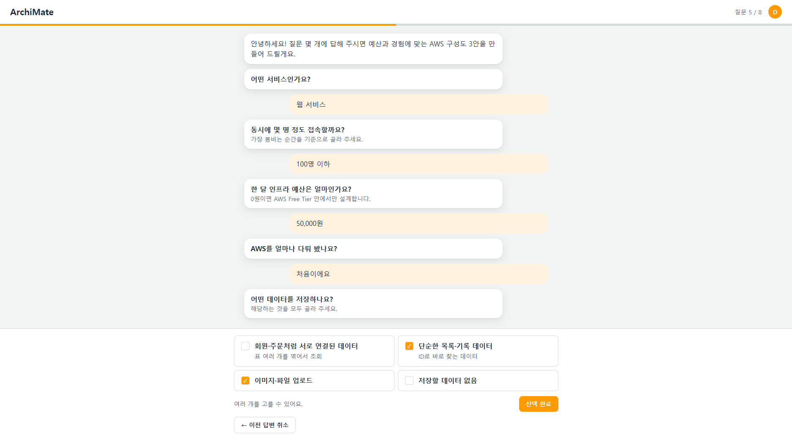
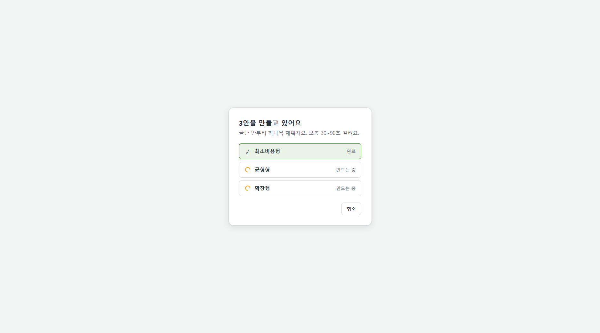
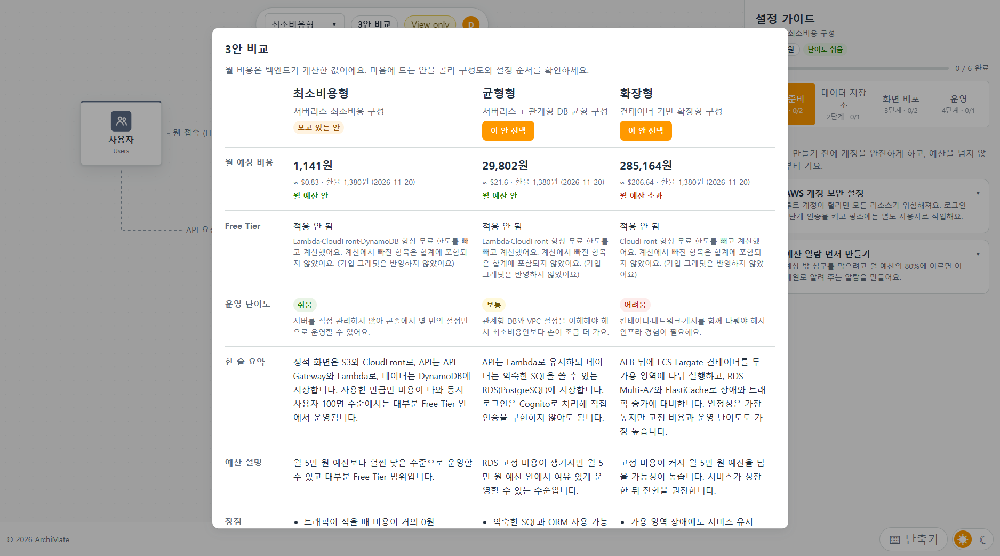
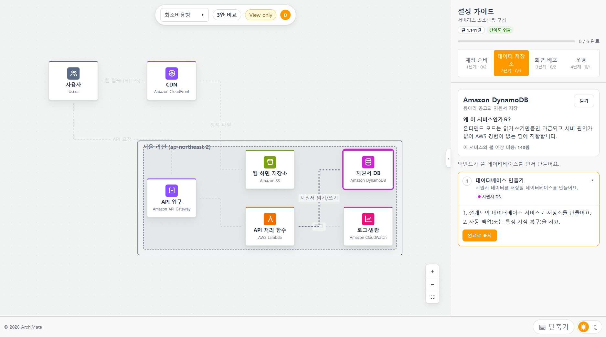
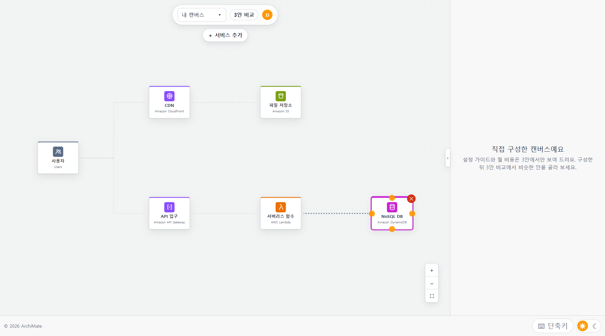
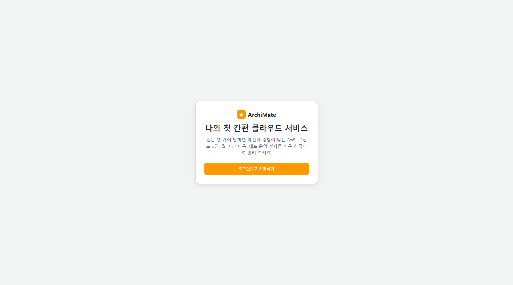
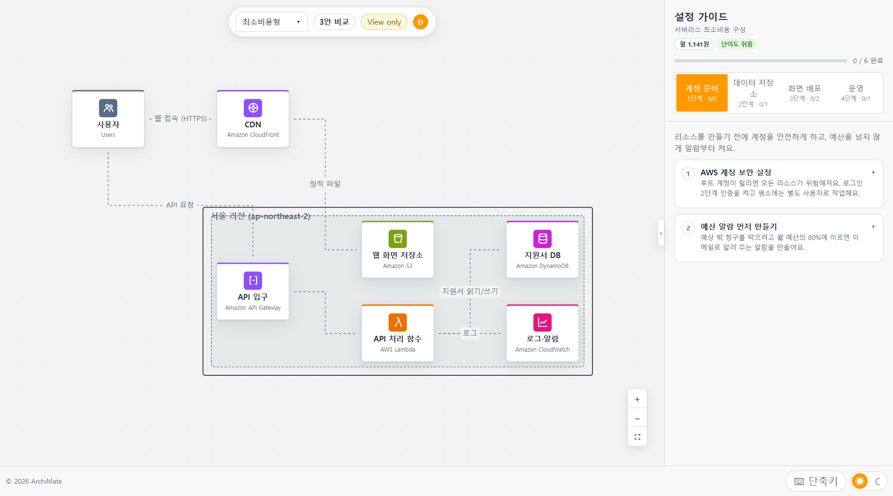
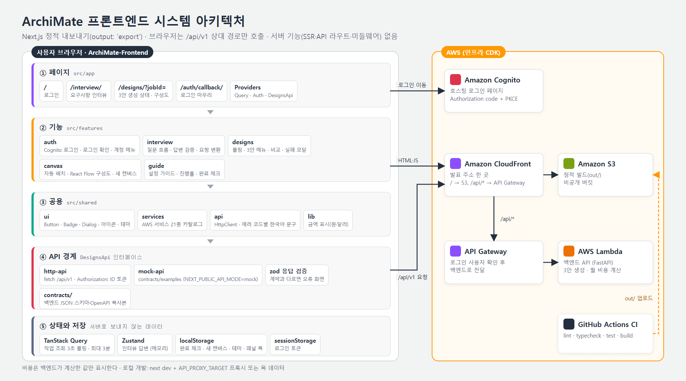

# 🏗 ArchiMate, "나의 첫 간편 클라우드 서비스"

> 혼자서도 관리할 수 있는 서비스로 바꿔 주는 AI 클라우드 설계 플랫폼입니다!

질문 몇 개에 답하면 예산과 경험에 맞는 AWS 구성도 3안, 월 예상 비용, 배포·운영 절차를 쉽게 알려 드립니다.
<br/>
이 저장소는 ArchiMate의 프론트엔드(Next.js 정적 웹)입니다.

## 🎥 배포·시연 영상 링크

| 구분 | URL |
| :---: | :--- |
| **프론트엔드** | https://dclawjdtcvp1i.cloudfront.net (AWS 2차 배포 후 공개) |
| **백엔드** | 같은 주소의 `/api/v1` (CloudFront → API Gateway) |
| **인프라** | - |
| **시연 영상** | - |

---

## ✨ 프론트엔드 핵심 기능 (Key Feature)

### 1. 채팅형 요구사항 인터뷰

* **기능 소개**

> 빈 입력창 대신 AI가 질문을 하나씩 건네고, 사용자는 보기를 골라 답합니다.<br/>
> 서비스 종류, 동시 접속자 수, 월 예산, AWS 사용 경험, 저장할 데이터 등 총 8개 질문이 있고, 선택 질문은 건너뛸 수 있습니다.<br/>
> 답을 마치면 요약표에서 확인하고, "여기부터 다시 답하기"로 이전 질문 내용을 고칠 수 있습니다.<br/>
> "3안 만들기"를 누르면 AI에게 맞춤형 클라우드 아키텍처 3안 생성을 요청합니다.<br/>
> 예산은 0원~1억 원만 받고, 서버가 거절할 조합(예: 저장 데이터 '없음'과 다른 항목 동시 선택)은 화면에서 먼저 막습니다.

* **UI 디자인**

> 

### 2. 3안 생성 상태와 비교

* **기능 소개**

> 생성 요청 뒤에는 3초마다 진행 상황을 확인하고(최대 3분), 최소비용형·균형형·확장형이 끝나는 대로 하나씩 "완료"로 바뀝니다.<br/>
> 끝나면 상단의 3안 선택 메뉴에서 안마다 월 비용, 운영 난이도, 예산 초과 여부를 보고 고를 수 있습니다.<br/>
> "3안 비교"에서는 월 비용(원·달러·환율), Free Tier 적용, 운영 난이도, 장단점, 성장 로드맵을 한 표로 비교합니다.<br/>
> 일부 안만 실패하면 메뉴에 표시하고 다시 시도할 수 있고, 전부 실패하면 이유와 함께 다시 시도 버튼을 보여 줍니다.<br/>
> 하루 생성 횟수를 넘으면 "내일 다시 시도해 주세요"라고 안내합니다.<br/>
> 비용은 백엔드가 계산한 값만 보여 주고, 프론트에서 계산하지 않습니다.

* **UI 디자인**

> 
>
> 

### 3. 구성도 캔버스와 설정 가이드

* **기능 소개**

> 선택한 안을 AWS 서비스 아이콘으로 그린 구성도로 보여 줍니다.<br/>
> 리전·VPC·서브넷은 상자로 묶이고, 좌표는 연결 흐름에 따라 자동으로 배치됩니다.<br/>
> 오른쪽 설정 가이드는 단계 탭(계정 준비 → 데이터 저장소 → 화면 배포 → 운영)과 진행률을 보여 줍니다.<br/>
> 단계를 누르면 할 일, 주의할 점, AWS 콘솔 경로가 펼쳐지고, 관련 서비스로 구성도가 확대됩니다. 완료 체크는 브라우저에 안별로 저장됩니다.<br/>
> 구성도에서 서비스를 누르면 "왜 이 서비스인가요?", "대안은 무엇인가요?", 주의할 점, 서비스별 월 비용을 보여 줍니다.<br/>
> 확대·축소·화면 맞춤 버튼, 보기 전용/편집 전환, 패널 폭 조절, 라이트·다크 테마, 단축키 안내를 제공합니다.

* **UI 디자인**

> 

### 4. 새 캔버스 (직접 구성)

* **기능 소개**

> 3안과 별개로, 빈 캔버스에 서비스를 직접 놓아 구성도를 그려 볼 수 있습니다.<br/>
> "서비스 추가"에서 21종 서비스 중 하나를 고르면 겹치지 않는 자리에 놓입니다.<br/>
> 서비스는 끌어서 옮기고, 블록 모서리에서 다른 블록으로 끌면 연결됩니다.<br/>
> 선택한 서비스나 연결선은 빨간 ✕ 버튼이나 Delete 키로 지웁니다.<br/>
> 직접 구성한 캔버스는 백엔드에 보내지 않고 브라우저에만 하나 저장됩니다.<br/>
> 설정 가이드와 월 비용은 3안에서만 제공합니다.

* **UI 디자인**

> 

### 5. 로그인

* **기능 소개**

> Amazon Cognito 호스팅 로그인 페이지로 로그인합니다(Authorization code + PKCE).<br/>
> 로그인하지 않으면 인터뷰와 구성도 화면에 들어갈 수 없고, 오른쪽 위 계정 메뉴에서 로그아웃합니다.<br/>
> 로컬 개발에서 Cognito 값을 비워 두면 로그인을 건너뛰고 임시 사용자로 동작합니다.

* **UI 디자인**

> 

---

## 🖼 전체 서비스 UI

> 

---

## ⚙ 시스템 아키텍처 (프론트엔드 파트)

> 

- 프론트는 정적 파일(`output: 'export'`)로 빌드해 S3에 올리고 CloudFront 한 곳에서 서비스합니다.
- Next.js 서버 기능(SSR, API 라우트, 미들웨어)은 쓰지 않습니다.
- 브라우저는 항상 `/api/v1/...` 상대 경로만 호출합니다.
- CloudFront가 `/api/*`를 API Gateway로 넘기므로 CORS 설정이 필요 없습니다.
- 로그인 토큰(ID 토큰)은 `sessionStorage`에 두고 API 요청의 `Authorization` 헤더로 보냅니다.

## ⛏ 기술 스택

| 구분 | 기술 스택 |
| :---: | :--- |
| **프레임워크** | Next.js 16 (App Router, 정적 내보내기), React 19 |
| **프로그래밍 언어** | TypeScript 6 |
| **스타일** | Tailwind CSS 4, Radix UI(Dialog·Dropdown), class-variance-authority |
| **구성도** | React Flow(`@xyflow/react`) |
| **상태 관리** | TanStack Query(서버 데이터·폴링), Zustand(인터뷰 답변) |
| **API 경계** | zod(응답 검증), openapi-typescript(백엔드 계약 타입 생성) |
| **로그인** | oidc-client-ts + Amazon Cognito 호스팅 로그인 |
| **테스트·품질** | Vitest, Testing Library, ESLint, Prettier |
| **실행 환경** | Node 26, pnpm 12 |
| **CI·배포** | GitHub Actions(린트·타입 검사·테스트·빌드), AWS S3 + CloudFront(CDK, 인프라 저장소) |

---

## 🏗 아키텍처 구조

> 기능 단위 폴더(`features/`)와 공용 모듈(`shared/`)로 나눴습니다. 화면은 API 인터페이스(`DesignsApi`)만 알고, 실제 HTTP인지 목 데이터인지는 모릅니다.

```text
ArchiMate-Frontend/
├─ src/
│  ├─ app/                      # 경로(페이지)와 Providers
│  │  ├─ page.tsx               # /                로그인
│  │  ├─ interview/             # /interview/      요구사항 인터뷰
│  │  ├─ designs/               # /designs/        3안 생성 상태·구성도
│  │  └─ auth/callback/         # /auth/callback/  로그인 마무리
│  ├─ features/
│  │  ├─ auth/                  # Cognito 로그인, 로그인 확인, 계정 메뉴
│  │  ├─ interview/             # 질문 흐름, 답변 검증, 요청 본문 변환
│  │  ├─ designs/               # API 어댑터(http·mock), zod 스키마, 폴링, 3안 메뉴·비교·실패 모달
│  │  ├─ canvas/                # 자동 배치, React Flow 구성도, 새 캔버스
│  │  └─ guide/                 # 설정 가이드 패널, 진행률, 완료 체크 저장
│  └─ shared/
│     ├─ api/                   # HTTP 클라이언트, 에러 코드별 한국어 문구, 생성된 API 타입
│     ├─ services/              # AWS 서비스 21종 카탈로그(이름·색·아이콘)
│     ├─ lib/                   # 금액 표시, 클래스 합치기
│     └─ ui/                    # Button, Badge, Dialog, 아이콘, 토스트, 테마, 단축키
├─ contracts/                   # 백엔드 계약 복사본(JSON 스키마, OpenAPI, 예시 응답)
├─ prototype/                   # 디자인 결정용 HTML 프로토타입(보존)
├─ docs/                        # 프론트 데이터 요구사항, API 목록
└─ .github/workflows/ci.yml     # CI
```

---

## 🚀 로컬 실행 방법

### 1. 의존성 설치

> Node 26과 pnpm이 필요합니다. 버전은 `.nvmrc`와 `package.json`의 `packageManager`에 고정되어 있습니다.

```shell
pnpm install
```

### 2. 환경 변수 설정

> `.env.example`을 복사해 `.env.local`을 만듭니다. 값은 커밋하지 않습니다.

```shell
cp .env.example .env.local
```

| 변수 | 설명 |
| :--- | :--- |
| `NEXT_PUBLIC_COGNITO_USER_POOL_ID`, `_CLIENT_ID`, `_REGION`, `_DOMAIN` | Cognito 로그인 값. 하나라도 비우면 로그인을 건너뜁니다. |
| `NEXT_PUBLIC_API_MODE` | `mock`이면 백엔드 없이 계약 예시 데이터로 동작합니다. 비우면 `/api/v1` 실제 API를 부릅니다. |
| `API_PROXY_TARGET` | `pnpm dev`에서만 `/api/v1`을 이 주소로 넘깁니다. 예: `http://localhost:8000` 또는 배포된 CloudFront 주소 |

- 백엔드 없이 화면만 보려면 Cognito 값을 비우고 `NEXT_PUBLIC_API_MODE=mock`으로 둡니다.
- 목 모드에서는 주소에 `?state=partial-failed` 또는 `?state=failed`를 붙여 실패 화면을 볼 수 있습니다.
    - 예: `/interview/?state=failed`

### 3. 개발 서버 실행

> http://localhost:3000 에서 확인합니다.

```shell
pnpm dev
```

### 4. 검사와 빌드

> CI와 같은 순서입니다. 빌드 결과는 `out/` 폴더에 생깁니다.

```shell
pnpm lint
pnpm typecheck
pnpm test
pnpm build
```

- 백엔드 계약(`contracts/openapi.json`)이 바뀌면 `pnpm gen:api`로 API 타입을 다시 만듭니다.

---

## 📋 페이지 구성

| 경로 | 페이지 | 주요 기능 |
| :--- | :---: | :--- |
| `/` | 로그인 | Cognito 호스팅 로그인으로 이동, 이미 로그인했으면 인터뷰로 이동 |
| `/auth/callback/` | 로그인 마무리 | Cognito가 돌려준 코드를 토큰으로 바꾸고 인터뷰로 이동 |
| `/interview/` | 요구사항 인터뷰 | 채팅형 질문 8개, 답변 요약과 수정, 3안 생성 요청 |
| `/designs/?jobId={jobId}` | 3안 생성·구성도 | 생성 진행 상태, 3안 선택·비교, 구성도, 설정 가이드, 서비스 설명, 실패 안내와 다시 시도, 새 캔버스 |

- 정적 내보내기라서 동적 경로 대신 쿼리 문자열(`?jobId=`)과 끝 슬래시(`trailingSlash: true`)를 씁니다.
- 생성 결과는 30일 동안 보관되어, 같은 주소로 다시 열 수 있습니다.
